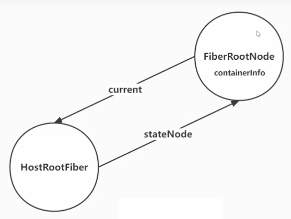
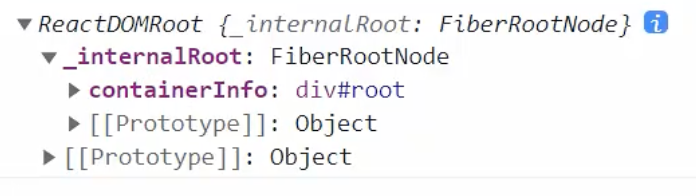
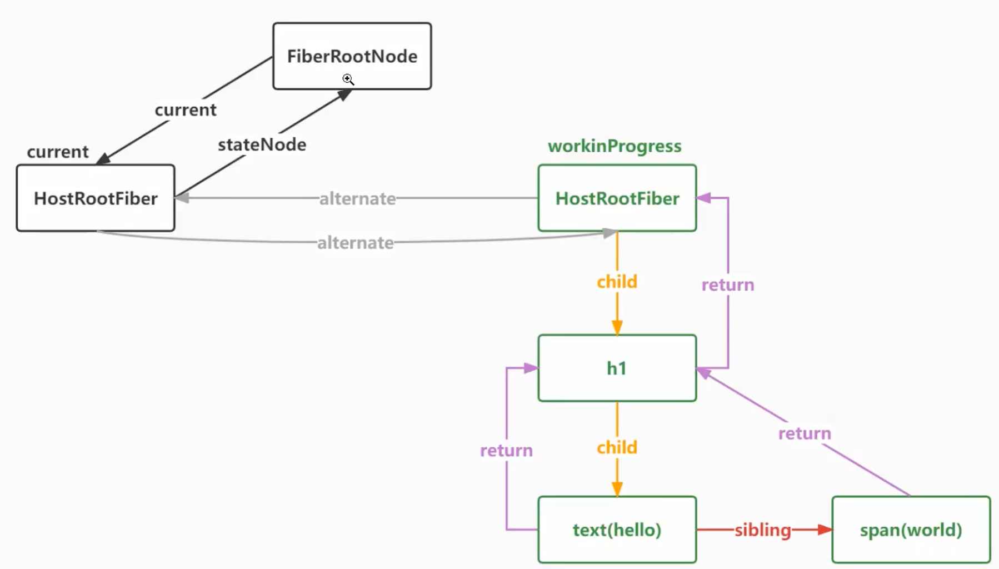
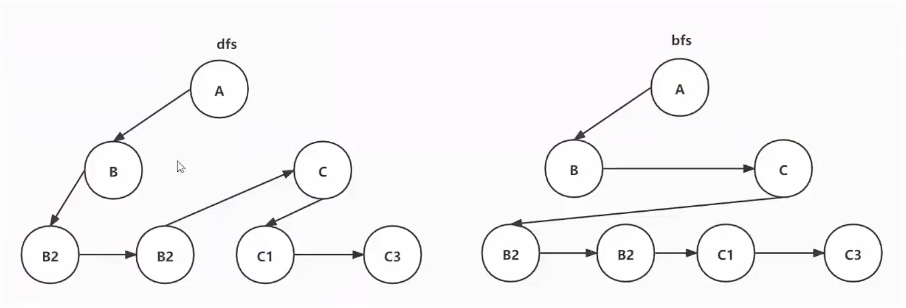
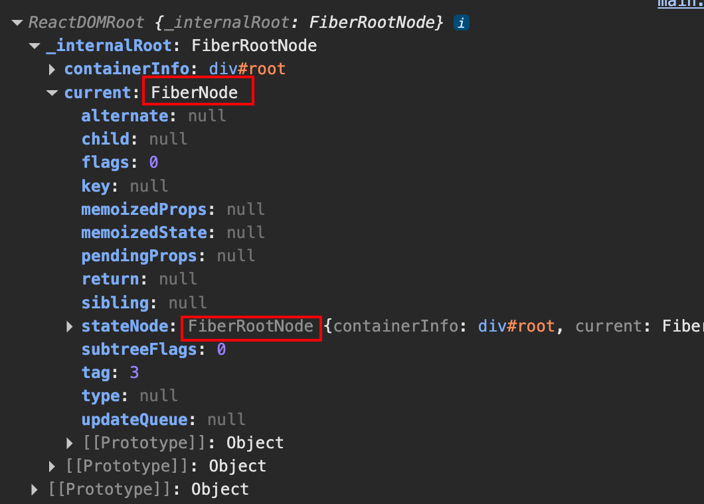
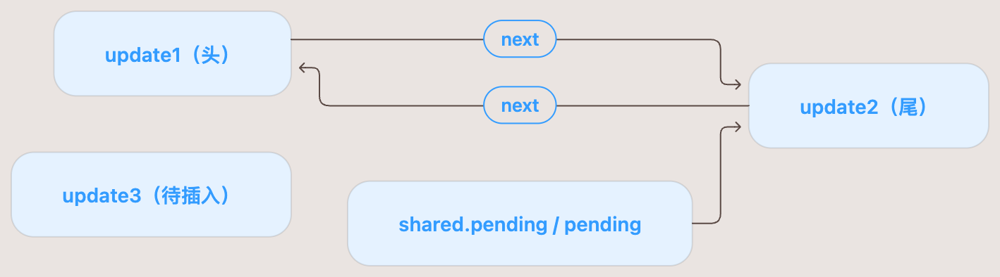
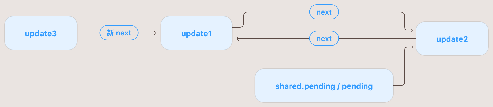
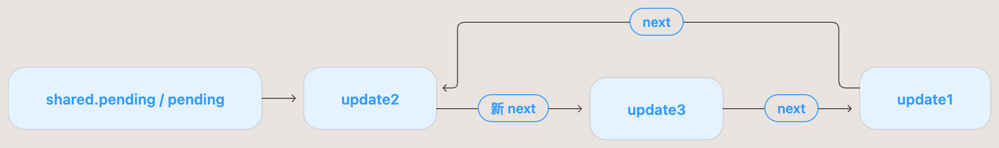
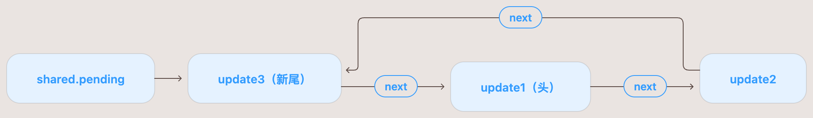

# 02-创建FiberRoot

如下代码：

```jsx
import { createRoot } from 'react-dom/client'

const element = (
  <h1>
    hello <span style={{ color: 'red' }}>world</span>
  </h1>
)

console.log(element)
const root = createRoot(document.querySelector('#root'))
root.render(element)
```

这一节主要实现图中的步骤：



## createRoot

`createRoot` 传递一个 container 参数，是一个挂载的容器节点，通过 `createContainer` -> `createFiberRoot` -> `new FiberRootNode` 将 container 信息保存起来，也就是：

```js
function FiberRootNode(containerInfo) {
  // 外部createRoot传递的容器信息，也就是 div#root 这个dom节点
  this.containerInfo = containerInfo
}
```

虽然名字叫 `createContainer`，它并不会创建一个 DOM 容器。container 已经是你通过 `document.querySelector('#root')` 找到的真实 DOM。然后将返回的 `FiberRootNode` 实例，绑定到 `ReactDOMRoot` 的 `_internalRoot` 上



调用链是：

```text
createContainer(container)
  → createFiberRoot(...)
    → new FiberRootNode(...)
  ← 返回 FiberRootNode 实例
```

简单来说：`FiberRootNode` 就是等于 `containerInfo` 的，它的本质就是一个真实的容器DOM节点

## Fiber

React执行任务的最小单元，将一个大任务进行拆分，拆分成一个个的Fiber单元，在浏览器的空闲时间进行执行。

一个Fiber是不可再拆分，执行单个 Fiber 是不能被中断的。Fiber树是通过虚拟DOM树构建出来的。

> 虚拟DOM只是用来描述的，使用Fiber来扩展虚拟DOM的数据结构，使其能够拥有状态

Fiber树的数据结构如下：



## 树的遍历（补充）



> 深度优先（dfs）和 广度优先（bfs）

## 创建根Fiber

```js
// 创建根Fiber（FiberRootNode）
export function createFiberRoot(containerInfo) {
  const root = new FiberRootNode(containerInfo)

  // 创建一个未初始化的fiber，HostRoot指的就是根节点div#root
  const uninitializedFiber = createHostRootFiber()
  root.current = uninitializedFiber
  uninitializedFiber.stateNode = root
  return root
}
```

核心是：

```js
// 创建一个未初始化的fiber，HostRoot指的就是根节点div#root
const uninitializedFiber = createHostRootFiber()
root.current = uninitializedFiber
uninitializedFiber.stateNode = root
```

也就是图中的这个部分：


将 `FiberRootNode` 的 current 执向 `HostRootFiber`，然后 `HostRootFiber` 的 `stateNode` 指向 `FiberRootNode`

## 二进制计算

```js
let Placement = 0b001
let Update = 0b010
let flags = 0b00
```

1. 增加操作：使用 `|=` 运算
2. 删除操作：使用 `flags = flags & ~Placement`
3. 判断是否包含：使用 `(flags & Placement) === Placement`
4. 判断不包含：使用 `(flags & Placement) === 0`

## 其他

- 为什么要构建fiber？

> 因为希望把构建fiber树的过程，或者说渲染过程变为可中断、可暂停和恢复的过程

- 验证FiberRoot结构



## updateQueue.js

[./updateQueue.js](./updateQueue.js) 中的 enqueueUpdate 方法的else解释：

```js
function enqueueUpdate(fiber, update) {
  ...
  } else {
    // 如果更新队列不为空的话，取出第一个更新
    update.next = pending.next
    // 然后让原来队列的尾部指向新的next
    pending.next = update
  }
}
```

假设队列已经有 update1、update2，现在插入 update3。pending 指向尾节点，pending.next 指向头节点

① 插入前：尾节点是 update2，它的 next 指回 update1。



② 执行 update.next = pending.next。

此时 update 是 update3，pending.next 是 update1，所以等价于：`update3.next = update1`，新节点指向原来的头节点，原队列的连接还没改变：



③ 执行 pending.next = update。

等价于 `update2.next = update3`，把原来 update2 → update1 的连接，改成 update2 → update3。三个节点现在组成一个环：



④ 最后执行 updateQueue.shared.pending = update。
将队列的尾指针更新为 update3：



这时 shared.pending 是 update3，shared.pending.next 仍然是头节点 update1。
