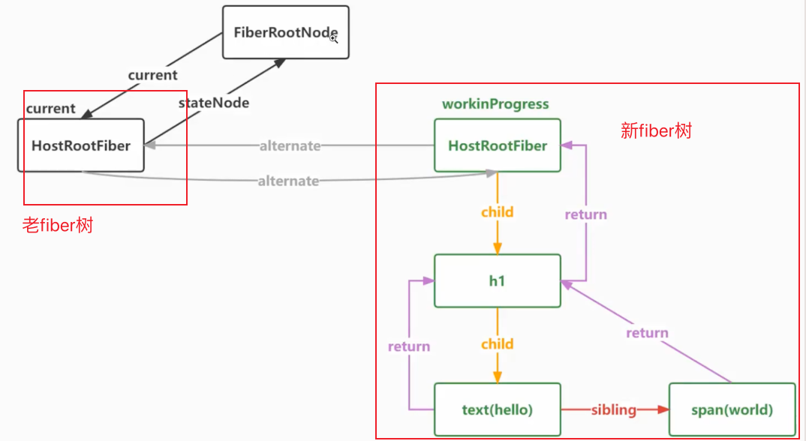

# 04-beginWork

react更新分为两个阶段：render和commit，然后有新旧两棵fiber树。

- render 阶段：构建本次更新的 Fiber 树，计算需要进行哪些变更。构建时会复用已有的 Fiber 节点。
- commit 阶段：把计算出的变更应用到真实 DOM，并将 root.current 指向本次完成的 Fiber 树。
- 双缓冲：一棵是当前已提交的 current 树，另一棵是正在构建的 workInProgress 树，对应节点通过 alternate 关联。提交后两棵树交换角色，旧树可以供下次更新复用。

当触发更新构建新的fiber树，然后新的fiber树构建完成后一次性去替换旧的fiber树，也就是commit过程，这个就是双缓冲技术

> 两棵树：
>
> - 旧树：对应页面上的真实dom元素，代表当前已经渲染完成的fiber
>
> - 新树：对应正在构建中的新的fiber树，表示还没有生效，没有更新到dom上的fiber树

