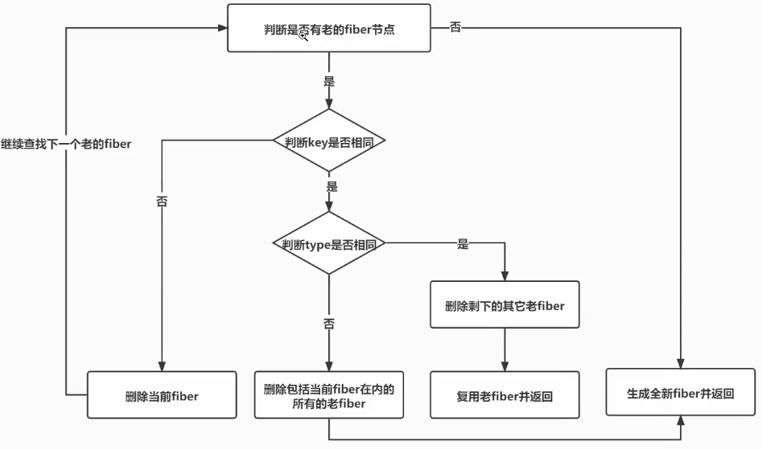
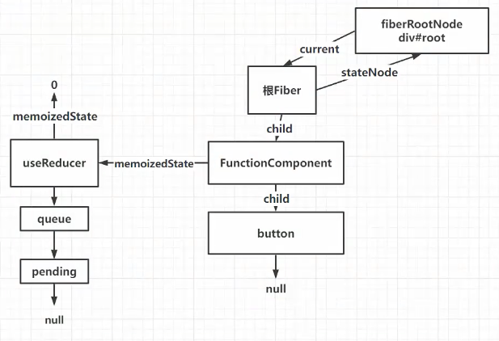
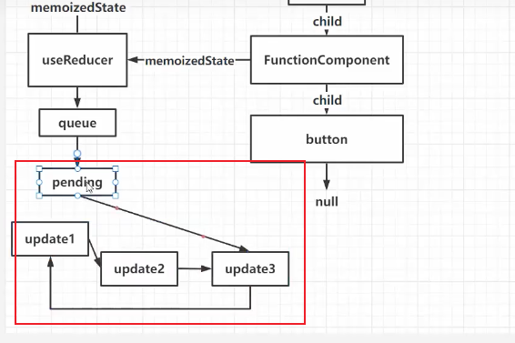
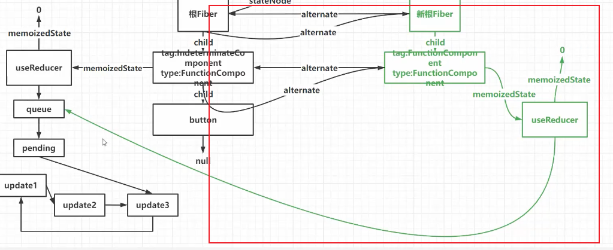

# 15-updateReducer

如果新的虚拟dom是一个单节点，走：



下面的代码：

```jsx
function FunctionComponent() {
  const [number, setNumber] = React.useReducer(counter, 0)
  return (
    <button
      onClick={() => {
        setNumber({ type: 'add', payload: 1 }) // update1 -> update2 -> update3 -> update1
        setNumber({ type: 'add', payload: 2 }) // update2
        setNumber({ type: 'add', payload: 3 }) // update3
      }}
    >
      {number}
    </button>
  )
}

const element = <FunctionComponent />
```

初次挂载完成后的fiber树如下：



执行3次setNumber更新前的fiber，如下框出部分：



更新部分：



## 本地更改源码查看

先从 `src/react-reconciler/src/ReactFiberBeginWork.js` 的 `beginWork` 开始，新增了 `FunctionComponent` 类型，这时候的 `FunctionComponent` 代表更新阶段，因为挂载阶段是 `IndeterminateComponent`。

然后是 `src/react-reconciler/src/ReactFiberHooks.js` 的 `renderWithHooks`，添加了初次挂载和更新的判断，更新执行 `updateReducer` 方法

然后在 `src/react-reconciler/src/ReactChildFiber.js` 的 `reconcileSingleElement` 新增了一些更新时的逻辑，更新时，根据新元素的 key 和 type，查找并复用旧 Fiber。

最后是 `src/react-reconciler/src/ReactFiberCompleteWork.js` 的 `completeWork` 方法，也增加了对于 `HostComponent` 在更新阶段的处理
