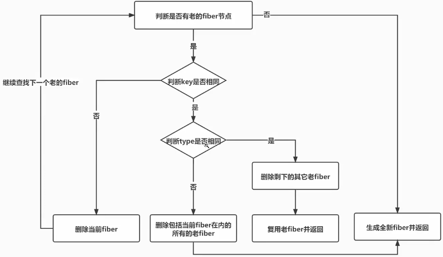
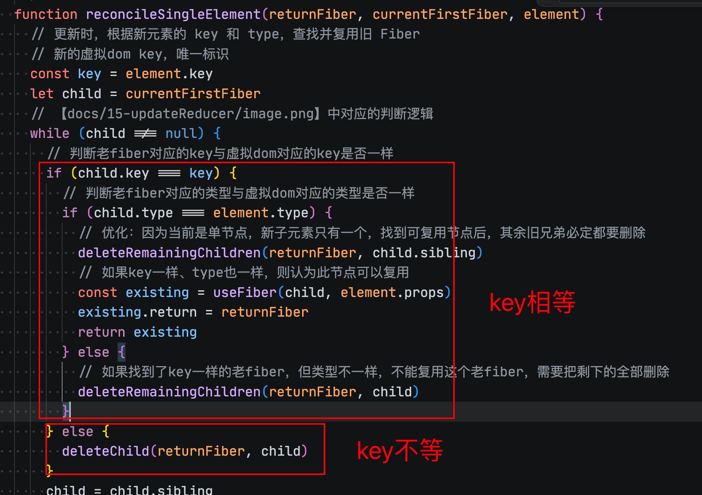
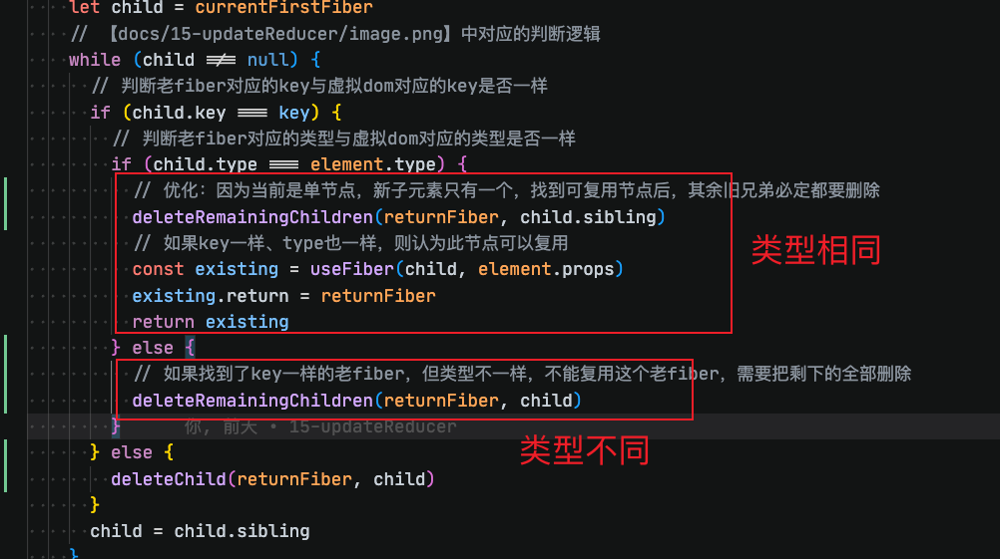

# 18-单节点diff

单节点diff情况有：

- 单节点key相同，类型相同
- 单节点key不同，类型相同
- 单节点key相同，类型不同
- 原来多个节点，现在只有一个节点

处理如下：



## 单节点key相同，类型相同

- 复用老节点，更新属性和文本内容

`main.jsx`：

```jsx
function FunctionComponent() {
  const [number, setNumber] = React.useState(0)
  return number === 0 ? (
    <div
      onClick={() => setNumber(number + 1)}
      key='title'
      id='title'
    >
      title
    </div>
  ) : (
    <div
      onClick={() => setNumber(number + 1)}
      key='title'
      id='title2'
    >
      title2
    </div>
  )
}
```

## 单节点key不同，类型相同

- 删除老节点，添加新节点

`main.jsx`：

```jsx
function FunctionComponent() {
  const [number, setNumber] = React.useState(0)
  return number === 0 ? (
    <div
      onClick={() => setNumber(number + 1)}
      key='title'
      id='title'
    >
      title
    </div>
  ) : (
    <div
      onClick={() => setNumber(number + 1)}
      key='title2'
      id='title2'
    >
      title2
    </div>
  )
}
```

## 单节点key相同，类型不同

- 删除老节点，添加新节点

```jsx
function FunctionComponent() {
  const [number, setNumber] = React.useState(0)
  return number === 0 ? (
    <div
      onClick={() => setNumber(number + 1)}
      key='title'
      id='title'
    >
      title
    </div>
  ) : (
    <p
      onClick={() => setNumber(number + 1)}
      key='title'
      id='title'
    >
      title
    </p>
  )
}
```

## 原来多个节点，现在只有一个节点

- 删除 A、C 节点，复用 B 节点并更新其属性和文本内容（因为是单节点diff）

`main.jsx`：

```jsx
function FunctionComponent() {
  const [number, setNumber] = React.useState(0)
  return number === 0 ? (
    <ul
      key='container'
      onClick={() => setNumber(number + 1)}
    >
      <li
        key='A'
        id='A'
      >
        A
      </li>
      <li
        key='B'
        id='B'
      >
        B
      </li>
      <li
        key='C'
        id='C'
      >
        C
      </li>
    </ul>
  ) : (
    <ul
      key='container'
      onClick={() => setNumber(number + 1)}
    >
      <li
        key='B'
        id='B2'
      >
        B2
      </li>
    </ul>
  )
}
```

## 本次更改

diff 在 render（协调）阶段计算，commit（提交）阶段执行计算出的变更

1. render 阶段：比较并记录

- 比较新旧节点的 key、type，决定复用、创建或删除。
- 比较属性差异。
- 把结果记录到 flags、deletions、updateQueue 等字段中。

2. commit 阶段：执行变更

- 根据这些记录，插入、删除或更新真实 DOM。

### `src/react-reconciler/src/ReactChildFiber.js

在这个文件中有 `reconcileSingleElement` 方法，用于协调单节点的虚拟dom。

先比较key是否相等：



如果key不相等，就删除旧的子fiber节点，然后在对应的父节点上标记副作用，以及添加`deletions`属性

然后如果key相等，那就需要再去比较类型是否相等。



如果类型不同，删除子节点和其他的兄弟节点。

解释`deleteRemainingChildren` 和 `deleteChild`的区别：

```txt
如果找到了key一样的老fiber，但类型不一样，需要删除自己和自己的兄弟
和child.key === key执行deleteChild的区别是：
1、首先是单节点diff，外层key不同，但是兄弟的key、type可能会相同，所以只删除自己
2、deleteRemainingChildren是因为key、type都不相同了，而且key是唯一的，又是单节点，那兄弟肯定不同，所以需要循环把兄弟都删除后，break
```

最后的情况就是复用了

### `src/react-reconciler/src/ReactFiberCommitWork.js`

提交阶段去执行更新，在`commitMutationEffectsOnFiber`的`recursivelyTraverseMutaionsEffects`方法中，新增了逻辑：先删除当前fiber记录的待删除的节点，然后调用 `commitDeletionEffectsOnFiber` 删除旧fiber

旧fiber的删除需要先删除它的子节点，然后再删除自己。

删除子节点的时候需要递归调用 `commitDeletionEffectsOnFiber`
