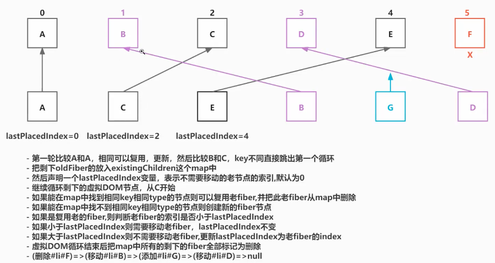

# 19-多节点diff

多节点的dom diff的三个规则：

1. 只对同级元素进行比较，不同层级不对比
2. 不同的类型对应不同的元素
3. 可以通过key来标识同一个节点

- 第一轮遍历：
  - 如果 `key` 不同，直接结束第一轮遍历
  - `newChildren` 或 `oldFiber` 遍历完，结束第一轮遍历：因为old3，new4，或者old4，new3，都只进行3次循环
  - `key` 相同而 `type` 不同，将旧的 `oldFiber` 标记为删除，继续遍历
  - `key` 相同且 `type` 相同，复用旧的 `oldFiber` 节点，继续遍历

- 第二轮遍历：
  - `newChildren` 遍历完而 `oldFiber` 还有剩余，将剩余的所有 `oldFiber` 标记为删除，diff 结束
  - `oldFiber` 遍历完而 `newChildren` 还有剩余，将剩余的新节点标记为插入，diff 结束
  - `newChildren` 和 `oldFiber` 都遍历完成，diff 结束
  - `newChildren` 和 `oldFiber` 都没有遍历完成，进入节点移动的逻辑

- 第三轮遍历：
  - 处理节点移动的情况（最复杂）
    

## 本次变更

只有 `src/react-reconciler/src/ReactChildFiber.js` 的 `reconcileChildArray` 这个方法，针对于多节点的diff

reconcileChildArray 其实这个多节点diff的过程其实就是找当前节点是复用、新增、删除、还是移动了，需要记录副作用

在需要跟踪副作用时：

| 处理结果                   | 记录的结构副作用                                  |
| -------------------------- | ------------------------------------------------- |
| 复用，不需要移动           | 不标记 `Placement`                                |
| 复用，但需要移动           | 标记 `Placement`                                  |
| 新建，需要插入             | 标记 `Placement`                                  |
| 旧节点没有被复用，需要删除 | 加入父 Fiber 的 `deletions`，标记 `ChildDeletion` |
