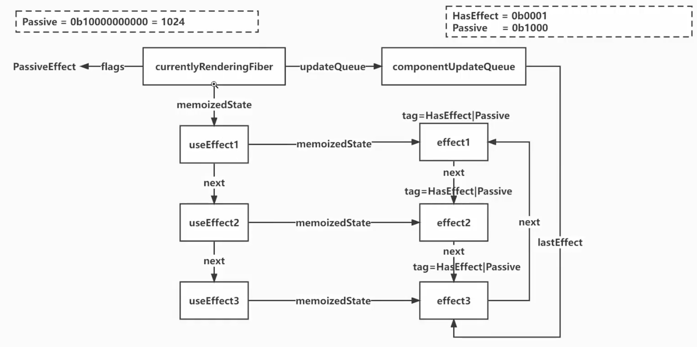

# 20-useEffect-01

分别有两个tag，一个是fiber的tag，另一个是hook的tag，主要是针对的是effect

函数组件类型的useEffect数据结构：



## 源码解读

### `src/react-reconciler/src/ReactFiberHooks.js`

先新增 `useEffect` 的两个阶段：`mount` 和 `update`

- `mountEffect`：首次渲染时创建一个 Effect，挂到当前函数组件的 Fiber 上，等待后续执行

- `updateEffect`：在组件更新时比较新旧依赖，决定这个 effect 本轮是否需要执行，再通过 pushEffect 保存它

### `src/react-reconciler/src/ReactFiberWorkLoop.js`

然后就是 `commitRoot` 去提交更新，执行顺序是：

```js
// 1. 登记一个稍后执行的任务。
// 浏览器先记住 flushPassiveEffect，当前代码继续往下走。
scheduleCallback(flushPassiveEffect)

// 2. 根据新树 B 的标记，修改页面上的 DOM。
commitMutationEffectsOnFiber(finishedWork, root)

// 3. 重置调度标记，让之后的提交可以再次安排任务。
rootDoesHavePassiveEffect = false

// 4. 保存根对象，让稍后的任务知道要处理哪个根。
rootWithPendingPassiveEffect = root

// 5. 让这个根对象指向新树 B。
root.current = finishedWork
```

等当前同步代码执行完，浏览器有空闲时间时，才调用：

```js
function flushPassiveEffect() {
  const root = rootWithPendingPassiveEffect

  // 此时 root.current 已经是新树 B！
  commitPassiveUnmountEffects(root.current) // 执行需要执行的旧清理函数
  commitPassiveMountEffects(root, root.current) // 执行需要执行的新回调
}
```

⚠️：`commitMutationEffectsOnFiber`和`flushPassiveEffect`的分工：

```js
// commitRoot 中：先修改真实 DOM
commitMutationEffectsOnFiber(finishedWork, root)

// 后续任务中：执行 useEffect 的清理函数和回调
flushPassiveEffect()
```

例如：

```js
useEffect(() => {
  console.log(document.getElementById('count').textContent)
}, [count])

return <div id='count'>{count}</div>
```

当 count 变化时：

1. `commitMutationEffectsOnFiber` 把页面上的数字更新。
2. 后续 `flushPassiveEffect` 执行回调，读取到更新后的数字。

### `src/react-reconciler/src/ReactFiberWorkLoop.js` 的 `flushPassiveEffect`

`flushPassiveEffect`就是当函数更新的时候，执行destroy，以及执行effect的create

```js
// 先执行需要清理的 effect 的 destroy
commitPassiveUnmountEffects(root.current)
// 再执行本轮需要运行的 effect 的 create
commitPassiveMountEffects(root, root.current)
```

这两句可以理解成：**先清理上一次的 effect，再执行这一次的 effect。**

例如：

```js
useEffect(() => {
  console.log('执行 effect，count =', count)

  return () => {
    console.log('清理 effect，count =', count)
  }
}, [count])
```

传给 `useEffect` 的外层函数就是 `create`，它返回的函数就是 `destroy`。

假设 `count` 从 `0` 变成 `1`：

**① `commitPassiveUnmountEffects(root.current)`**

找到本轮需要重新执行的 effect，调用它保存的旧清理函数：

```js
const destroy = effect.destroy
if (destroy !== undefined) {
  destroy()
}
```

因此打印：`清理 effect，count = 0`

这个清理函数是在上一次渲染中创建的，所以读取的是上一次的 `count`。

**② `commitPassiveMountEffects(root, root.current)`**

再执行本轮的新回调，并保存新回调返回的清理函数：

```js
effect.destroy = effect.create()
```

因此打印：`执行 effect，count = 1`

新返回的清理函数会被保存，留给下一次清理时使用。
