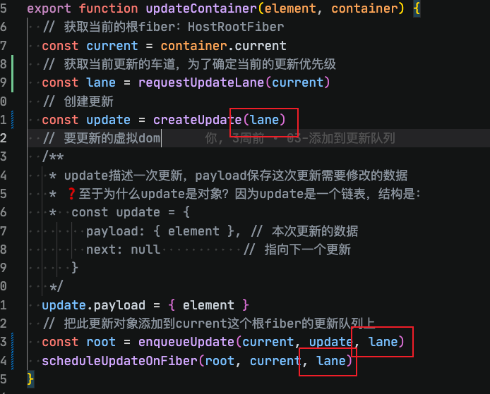

# 24-lane初次渲染

本次的源码修改，主要是针对于在初次渲染的时候，引入lane，主要是修改了一些传递的参数逻辑。

阅读顺序下面的1、2、3...

## 1、`src/react-reconciler/src/ReactFiberRoot.js`

这个文件分别要看 `FiberRootNode`，因为在原来的数据结构上添加了`pendingLanes`字段，用来记录这个根节点下，哪些 lane 上还有更新等待处理。

然后就是 `createFiberRoot` 方法，这个主要是在创建root容器的步骤，其中有`initialUpdateQueue` 方法，更改了fiber上的updateQueue更新队列的数据结构，可以记录到

## 2、`src/react-reconciler/src/ReactFiberReconciler.js`

先进入reconciler，在更新`updateContainer`方法中，需要获取当前更新的lane车道，确定当前的更新优先级，通过`requestUpdateLane`方法确认。

`requestUpdateLane`方法：判断全局定义的lane是否有，如果没有，就通过事件来判断，主要是分为离散事件、连续事件，来指定优先级。

然后就是在之前的方法中补充`lane`参数：

然后是`enqueueUpdate`方法和`scheduleUpdateOnFiber`方法

## 3、`src/react-reconciler/src/ReactFiberClassUpdateQueue.js` 的 `enqueueUpdate`

这里的`enqueueUpdate`，之前没有lane的逻辑是：fiber上的更新队列，有更新就插入到updateQueue上，有了lane之后的逻辑，就和`enqueueConcurrentHookUpdate`函数hook的一样了：暂存更新、找到根节点

## 4、`src/react-reconciler/src/ReactFiberWorkLoop.js` 的 `scheduleUpdateOnFiber`

主要的修改也就是添加lanes，把大部分的方法都添加lanes参数

## 5、`src/react-reconciler/src/ReactFiberBeginWork.js`

这个文件是`beginWork`方法中对于`HostRoot`的处理，也就是`updateHostRoot`方法（其他的类型后面会改）

先将workInProgress单独复制一份，因为前面 createWorkInProgress 中只是复制了引用：workInProgress.updateQueue = current.updateQueue，此时两个 Fiber 的 updateQueue 指向同一个对象，而接下来的 processUpdateQueue 会修改 updateQueue

然后就是对 `processUpdateQueue` 做的修改了

## 6、`src/react-reconciler/src/ReactFiberClassUpdateQueue.js` 的 `processUpdateQueue`

- 在引入 `lane` 前的逻辑：就是按顺序处理本次队列里的所有更新，最后把计算结果一次性赋给 memoizedState

- 在引入 `lane` 后：循环更新队列，判断当前更新对象是否满足lanes的更新条件，如果满足就执行更新，计算新的state，如果不满足就跳过
